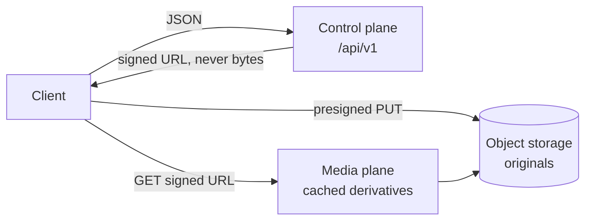

<div align="center">

# OpenPic

**The OpenPic API — event photography delivery for organisers and their guests.**

Organisers upload an event's photos; attendees open one link, take a selfie, and
get only their own pictures — at full resolution, watermarked previews, and
downloads under the event's rules.

[](LICENSE)
[](https://github.com/yahodu/openpic-webapp/actions/workflows/ci.yml)
[](https://nextjs.org)
[](https://www.typescriptlang.org)
[](https://nodejs.org)
[](https://pnpm.io)
[](https://www.mongodb.com)

</div>

---

## Table of contents

- [What this repository is](#what-this-repository-is)
- [How it works](#how-it-works)
- [Features](#features)
- [Tech stack](#tech-stack)
- [Repository layout](#repository-layout)
- [Getting started](#getting-started)
- [Scripts](#scripts)
- [Testing](#testing)
- [API at a glance](#api-at-a-glance)
- [Documentation](#documentation)
- [Contributing](#contributing)
- [Security](#security)
- [License](#license)

## What this repository is

This repository is the **backend** of OpenPic: a Next.js (App Router) API that
serves the organiser dashboard, the attendee page and the admin console. It
contains HTTP route handlers, the server-side domain layer, the shared Zod
contracts, and the full test suite.

It does **not** contain a browser UI — the routes under `apps/web/src/app` are
API handlers only. Clients (web / mobile) consume the JSON API described in the
[API contract](docs/API%20Contract.md).

## How it works

Three planes keep image bytes out of the JSON API, in both directions.



| Plane   | Carries         | Authorisation                                                      |
| ------- | --------------- | ------------------------------------------------------------------ |
| Control | JSON            | Better Auth session, bearer token, attendee session, internal HMAC |
| Media   | image bytes out | path-bound HMAC signature with an expiry                           |
| Storage | image bytes in  | presigned S3 PUT                                                   |

A request therefore never proxies an image: the handler authorises, then signs a
URL. The full component map, sequence diagrams and state machines are in
[`docs/Diagrams.md`](docs/Diagrams.md).

## Features

- **Identity** — email/phone OTP sign-in, optional second factor, session and
  device management, account deletion.
- **Tenancy and collaboration** — tenants with members and roles, invitations,
  event-scoped collaborators, tenant isolation enforced in every query.
- **Billing** — plans catalogue, entitlements and usage counters, subscribe /
  upgrade / downgrade / cancel, add-ons, invoices, transactions, dunning and
  scheduled plan changes. Provider behind an adapter (Cashfree / Stripe).
- **Events** — CRUD, archive, upload windows, public access links and QR codes,
  branding assets.
- **Uploads and media** — multipart presigned uploads and upload sessions, batch
  resolution, derivative status and reprocessing, signed media URLs.
- **Attendee experience** — public event lookup, consent, liveness check,
  selfie upload, face-match, personal gallery, originals and downloads.
- **Notifications** — routing matrix, fan-out, digests, quiet hours, delivery
  retries, in-app feed, unread count, preferences, one-click unsubscribe.
- **Compliance and operations** — data-subject requests, consent history,
  retention sweeps, audit logs, health/readiness probes, HMAC-guarded cron
  endpoints, rate limiting, idempotency, ETag and cursor pagination.

## Tech stack

| Area      | Choice                                                                    |
| --------- | ------------------------------------------------------------------------- |
| Runtime   | Node.js ≥ 22.12, pnpm 11 workspace                                        |
| Framework | Next.js 15 App Router route handlers — API only, no browser UI here       |
| Language  | TypeScript 5, `strict`, no `any`                                          |
| Data      | MongoDB (driver + Atlas), replica set required for transactions           |
| Contracts | Zod schemas in `packages/contracts`, shared by handlers and clients       |
| Auth      | Better Auth (session cookie, OTP, second factor)                          |
| Storage   | S3-compatible object storage (Cloudflare R2) through presigned URLs       |
| Messaging | Novu workflows behind a transport port                                    |
| Payments  | Cashfree / Stripe behind a payment port                                   |
| Logging   | `pino` behind a `Logger` port (stdout or Better Stack)                    |
| Tests     | Vitest (unit + integration), Playwright (API journeys), MSW, in-memory DB |

## Repository layout

| Path                   | Contents                                                            |
| ---------------------- | ------------------------------------------------------------------- |
| `apps/web/src/app/api` | Route handlers — the HTTP surface                                   |
| `apps/web/src/server`  | Domain, services, repositories, adapters, jobs, security, tenancy   |
| `apps/web/src/test`    | Unit and integration specs, factories, MSW mocks                    |
| `apps/web/e2e`         | Playwright journeys across several routes                           |
| `packages/contracts`   | Zod request/response schemas and derived types                      |
| `docs`                 | API contract, architecture, conventions, ADRs, design notes         |
| `scripts`              | One-off admin processes: indexes, Novu sync, git hooks              |
| `eslint-rules`         | Local rules (no direct collection access, no direct vendor imports) |

## Getting started

### Prerequisites

- Node.js ≥ 22.12 (`.nvmrc` pins the version) and pnpm 11 (`corepack enable`).
- A MongoDB replica set. Transactions are used on several paths, so a standalone
  `mongod` is not enough; a local `rs.initiate()` or an Atlas cluster both work.
- Optional, only for the integration you are exercising: an S3-compatible bucket,
  Redis (rate limiting), Cashfree/Stripe keys, Novu keys. Every provider defaults
  to an in-memory double, so the app boots without them.

### Install and run

```bash
pnpm install --frozen-lockfile
cp .env.example .env          # then fill in the values you need
pnpm dev                      # http://localhost:3000
```

`pnpm dev` picks up `.env` itself. The one-off admin scripts read `process.env`
only, so export it first:

```bash
set -a; . ./.env; set +a
pnpm db:ensure-indexes
```

Check it is up:

```bash
curl -s localhost:3000/api/v1/health
```

`.env.example` documents every variable, with the production-only requirements
stated next to them. Never commit a real secret — the repo runs a secret scan on
every pull request.

### Configuration rules

- All configuration comes from the environment; validation happens once, in
  `apps/web/src/server/config/env.ts`, and a bad value fails fast with the
  variable name (never its value) in the error.
- Runtime tunables (limits, windows, feature switches) are **not** environment
  variables — they are read from the `platformSettings` document.
- Staging and production refuse to start on short secrets or a missing trusted
  client-IP header.

## Scripts

| Command                      | What it does                                                 |
| ---------------------------- | ------------------------------------------------------------ |
| `pnpm dev`                   | Start the API in development mode                            |
| `pnpm build` / `start`       | Production build (standalone output) / serve it              |
| `pnpm test`                  | Unit suite, then integration suite                           |
| `pnpm test:unit`             | Vitest `unit` project — pure logic, validators, guards       |
| `pnpm test:int`              | Vitest `integration` project — routes, DB, adapters          |
| `pnpm test:e2e`              | Playwright journeys against a built server                   |
| `pnpm test:coverage`         | Both Vitest projects with coverage thresholds                |
| `pnpm typecheck`             | `tsc --noEmit` across the workspace and both packages        |
| `pnpm lint`                  | ESLint (flat config, includes the local rules)               |
| `pnpm format`                | Prettier write; `format:check` for the CI form               |
| `pnpm audit`                 | Dependency audit at `moderate` and above                     |
| `pnpm db:ensure-indexes`     | Create collections, indexes and TTL indexes                  |
| `pnpm novu:upsert-workflows` | Push the notification workflow set to Novu                   |
| `pnpm novu:assert-no-drift`  | Fail when Novu's workflows differ from the repository's copy |

## Testing

The suite is the specification, and it is layered:

- **Unit** (`pnpm test:unit`) — pure functions, validators, mappers, guards and
  the repository's own documentation/ADR guards.
- **Integration** (`pnpm test:int`) — route handlers and services against
  `mongodb-memory-server` started as a **replica set** (transactions behave as in
  production) with every outbound HTTP call served by MSW configured with
  `onUnhandledRequest: "error"` — an unhandled request is a failure, not a warning.
- **E2E** (`pnpm test:e2e`) — Playwright, reserved for journeys that span several
  routes.

Fixtures are built only through `buildX(overrides)` factories that parse their own
output, so a fixture cannot drift from its schema. Coverage gates are 80% for the
whole of the included code and 90% for `server/domain` and `server/services`.

## API at a glance

- **Base path** `/api/v1`; the auth surface is `/api/auth/*` (library-owned).
- **Tenancy in the path** — `/api/v1/tenants/{tenantId}/…`, where `current` is
  accepted as an alias for the caller's active tenant.
- **Attendee surface** `/api/v1/p/*` — public, keyed by the event's slug and an
  anonymous attendee session, so no account is needed to see your own photos.
- **Internal surface** `/api/v1/internal/*` — server-to-server only, guarded by an
  HMAC signature and fetch-metadata checks; browser contexts are refused.
- **Envelopes, errors, pagination, idempotency, ETags, rate limits** are normative
  in the [API contract](docs/API%20Contract.md) — read Part 0 before adding a
  route.

## Documentation

| Document                                                                           | Read it for                                                    |
| ---------------------------------------------------------------------------------- | -------------------------------------------------------------- |
| [API Contract](docs/API%20Contract.md)                                             | Endpoints, envelopes, error codes, entitlements, cron, workers |
| [Architecture diagrams](docs/Diagrams.md)                                          | Planes, components, sequences, state machines                  |
| [Notification and Database Design](docs/Notification%20and%20Database%20Design.md) | Collections, indexes, notification routing matrix              |
| [Subscription flow](docs/Subscription%20flow.md)                                   | Billing lifecycle from checkout to dunning                     |
| [Upload flow](docs/Upload%20flow.md)                                               | Presigned multipart upload to derivative publication           |
| [Engineering conventions](docs/CONVENTIONS.md)                                     | The authoritative standard: TDD, contracts, logging, DoD       |
| [Architecture Decision Records](docs/adr/README.md)                                | Why each expensive-to-reverse decision was made                |
| [Contributing](CONTRIBUTING.md)                                                    | Workflow, review gates, contribution terms                     |
| [Agent operating rules](AGENTS.md)                                                 | How autonomous agents pick up, land and review work            |

## Contributing

Contributions come from contributors the owner has added to the repository.
Before you start, read [CONTRIBUTING.md](CONTRIBUTING.md): it covers the branch
and commit format, the test-first workflow, the coding conventions, the ADR
process, the pull-request gates, and the contribution terms that let the owner
relicense the project later.

Agents work to the same rules; [AGENTS.md](AGENTS.md) is their entry point.

## Security

Please do not open a public issue for a vulnerability. Report it privately through
[GitHub security advisories](https://github.com/yahodu/openpic-webapp/security/advisories/new)
with the affected route, a reproduction and the impact you believe it has. The
maintainers triage reports privately.

## License

**Proprietary — all rights reserved.** You may read the code and evaluate it, but
you may not use, run, host, modify or distribute it, for free or for money,
without the owner's written permission. Contributions are welcome from approved
contributors and are licensed to the owner so the license can change in the
future. The full terms are in [LICENSE](LICENSE).

Third-party packages keep their own licenses; the audit confirming that those
terms do not prevent this license is recorded in
[ADR-0991](docs/adr/ADR-0991-proprietary-license.md).
